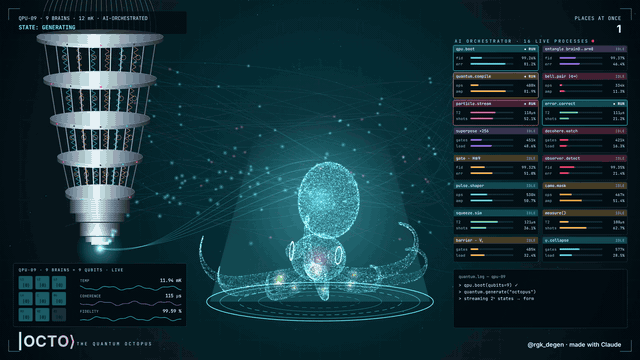
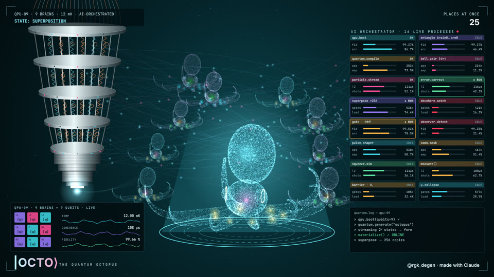
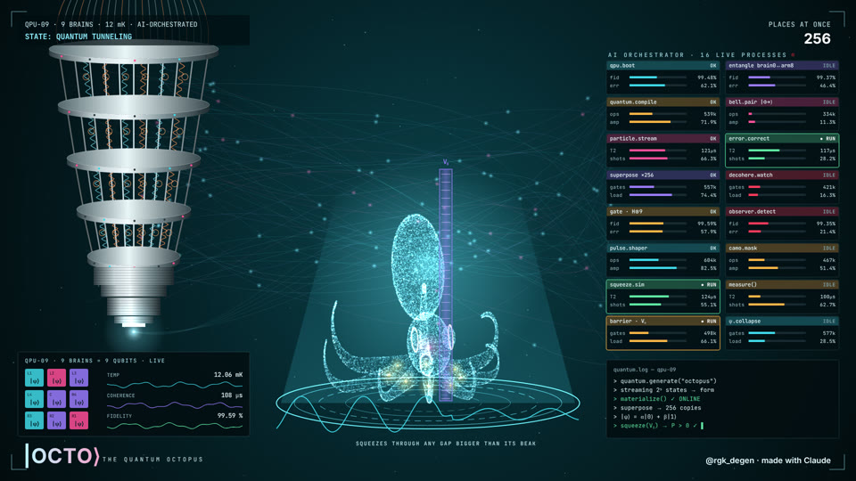
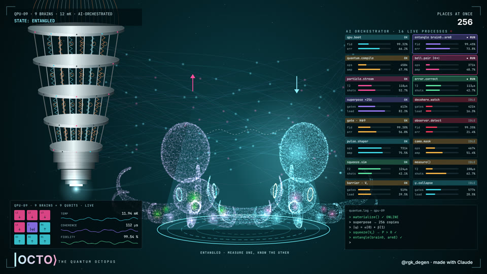
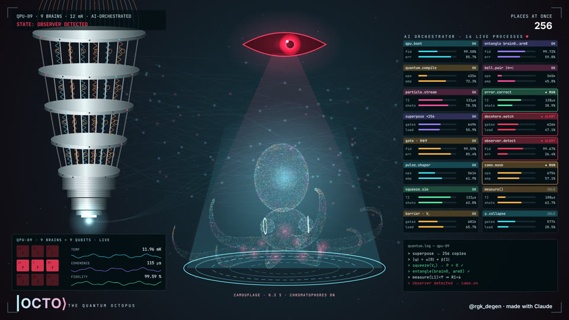

<div align="center">

# |OCTO⟩ — The Quantum Octopus

**An octopus has 9 brains. So each brain got a qubit.**

A 28-second motion piece: a glass octopus is born inside a cryostat, spreads into 256 places at once, squeezes through a wall, gets an entangled twin, and goes invisible the moment someone looks at it.

[**▶ Live demo**](https://rgkdegen.github.io/quantum-octopus/) · [Download MP4](media/quantum-octopus.mp4) · [The post](POST.md) · [@rgk_degen](https://x.com/rgk_degen)



</div>

---

## The story in seven states

| t | State | What happens on screen |
|---|---|---|
| 0–3 s | `GENERATING` | Light streams out of the cryostat and assembles the octopus point by point. Its 9 brains come online one by one. |
| 3–8 s | `SUPERPOSITION` | Copies appear around it. **PLACES AT ONCE** climbs 1 → 256. |
| 8–10 s | `\|ψ⟩ = α\|0⟩ + β\|1⟩` | Two tinted ghosts flicker on either side and merge back into one. |
| 10–15 s | `QUANTUM TUNNELING` | A barrier V₀ appears and the octopus compresses to slip through. The wavefunction keeps going on the other side. *(Real octopuses fit through any gap bigger than their beak.)* |
| 15–20 s | `ENTANGLED` | A pink twin splits off. Their arrows flip in lockstep: measure one, know the other. |
| 20–23.5 s | `OBSERVER DETECTED` | A red eye opens and the processes go `ALERT`. The octopus switches on its chromatophores and fades into camouflage. |
| 23.5–28 s | `COLLAPSED → \|OCTO⟩` | A shockwave runs across the pad and only one octopus is left. Nine brains, one state. |

<table>
<tr>
<td><br><sub>SUPERPOSITION · 256 places at once</sub></td>
<td><br><sub>QUANTUM TUNNELING · through V₀</sub></td>
</tr>
<tr>
<td><br><sub>ENTANGLED · ↑ ⇄ ↓</sub></td>
<td><br><sub>OBSERVER DETECTED · camouflage on</sub></td>
</tr>
</table>

## What's on the screen

- **Cryostat** (left): a silver dilution refrigerator drawn procedurally, with five stages, rods, copper and cyan coils, blinking status LEDs and a beam emitter at the tip.
- **The octopus** (center): a 3D point cloud of about 30k points with mantle, head, gold-ringed eyes and 8 animated arms with suckers. It is rendered offscreen and composited additively. The nine brains glow inside: the central ring plus one ganglion per arm.
- **AI Orchestrator** (right): 16 processes (`superpose ×256`, `squeeze.sim`, `bell.pair |Φ+⟩`, `observer.detect`, `camo.mask`, `ψ.collapse`, …). Each one switches between IDLE, RUN, ALERT and OK on the story clock.
- **quantum.log**: a typed terminal that narrates every transition.
- **QPU-09 panel** (bottom left): the 9 brains laid out as a 3×3 qubit grid. They read `|0⟩`, then `|ψ⟩`, then `↑/↓` pairs, then `?`, and finally collapse into a fixed state. Live temperature, coherence and fidelity traces sit beside the grid.

## How it works

Everything is one file, [`index.html`](index.html), with no frameworks and no assets apart from two fonts.

```
render(t)   →   pure function of time: same t, same frame
   │
   ├─ open index.html in a browser          → live preview with play/pause/scrub
   └─ python render/render.py               → Playwright calls window.frame(t) for each frame
                                              → JPEG frames piped into ffmpeg (parallel workers)
                                              → segments joined + soundtrack muxed → MP4
```

- **Deterministic.** All randomness comes from a seeded PRNG (`mulberry32`), so any frame can be rendered on any machine in any order. That is what makes the parallel workers safe.
- **The soundtrack is code too.** [`render/audio.py`](render/audio.py) synthesizes a cryostat drone with numpy, plus hits locked to the timeline: a shimmer for superposition, a whoosh through the barrier, pings on each entanglement flip, an alarm for the observer and a chord on collapse.

## Run it

**Preview.** Open `index.html` in Chrome, or use the [live demo](https://rgkdegen.github.io/quantum-octopus/). `Space` plays and pauses, `←` and `→` seek, and the bar at the bottom scrubs.

**Render the video.**

```bash
pip install -r requirements.txt
python -m playwright install chromium     # once
# ffmpeg must be on PATH

python render/render.py                   # 1920×1080, 28 s, 30 fps → media/quantum-octopus.mp4
python render/render.py --fps 60 --workers 4
python render/render.py --start 10 --end 15 --out tunnel.mp4   # just one scene
python render/stills.py 5.5 17.5          # PNG stills → stills/
```

Or use `make video`, `make stills` or `make audio`.

## Make it yours

All timing lives in the `PH` array at the top of the scene script. Shift a boundary and every panel, the log, the counter and the soundtrack's anchors (`render/audio.py`) follow it. The color tokens are in `C`. The octopus anatomy (mantle, head, eyes, arm lift and curl) sits in the model block, where each body part is a few lines of point sampling.

## Repo layout

```
index.html            the scene (canvas renderer + live player)
fonts/                Inter + JetBrains Mono (SIL OFL 1.1)
render/render.py      parallel frame capture → ffmpeg → MP4
render/audio.py       procedural soundtrack
render/stills.py      single-frame PNG export
media/                final MP4, preview GIF, poster
docs/                 stills used in this README
POST.md               launch post for X
```

## Credits

Concept, direction and octopus character by [@rgk_degen](https://x.com/rgk_degen). Built with Claude. The format is inspired by the "quantum ghost" clips going around on X.

This is an illustrative schematic, not a physics simulation. The octopus facts are real: 9 brains (one central plus one ganglion per arm), it fits through any gap bigger than its beak, and it can camouflage in a fraction of a second.

Code: [MIT](LICENSE). Fonts: [SIL Open Font License](fonts/).
